# ORIF

Ce document présente globalement les divers éléments de l'application afin d'en apprendre plus testez l'application.

## Accueil
L'écran d'accueil nous permet de choisir un scénario à effectuer, de visualiser les astuces tel que les gestes à adopter, le fonctionnement des menus etc.. et de quitter l'application.

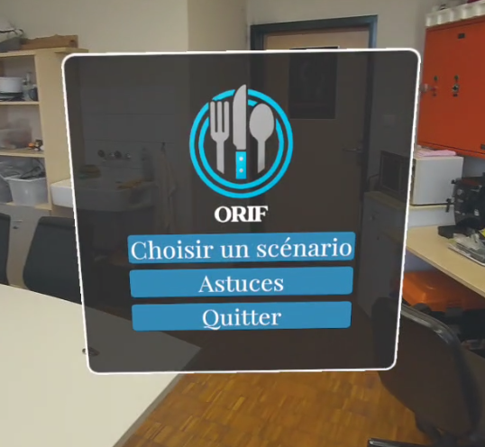

## Sélection et paramètres du scénario

Lorsqu'on ouvre le sélecteur de scénario, nous pouvons choisir plusieurs éléments tel que :
- L'utilisation des scénarios sur le serveur
- Le mode de scénario (apprentissage, entraînement, examen)
- La difficulté du scénario (débutant, intermédiaire, expert)
- Les validateurs
- Le temps à disposition

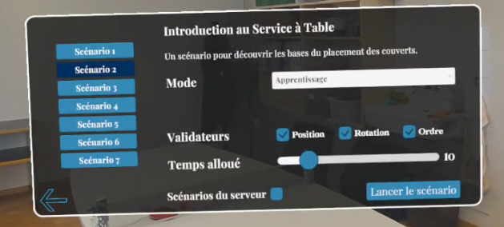
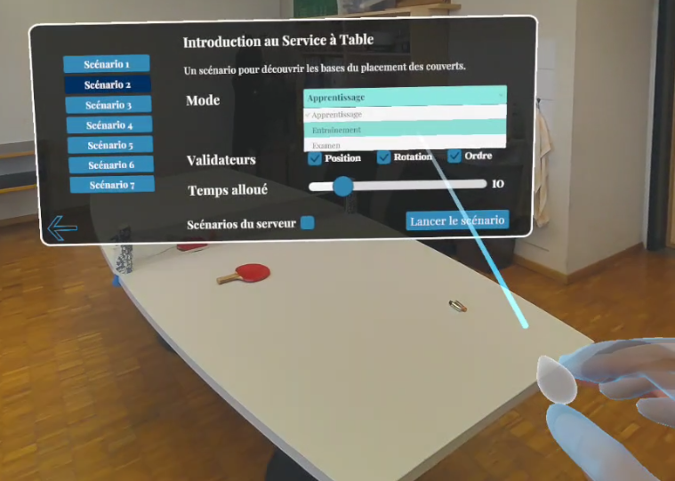
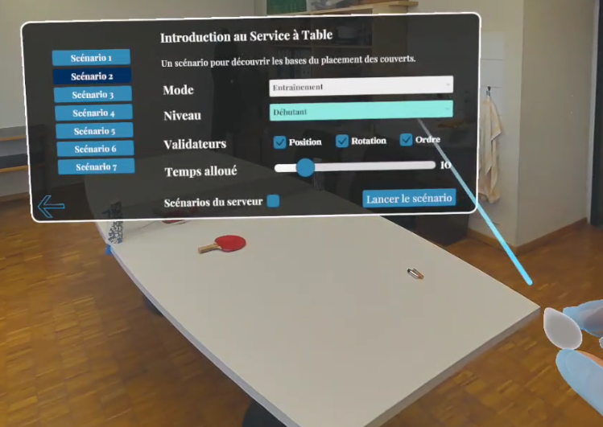
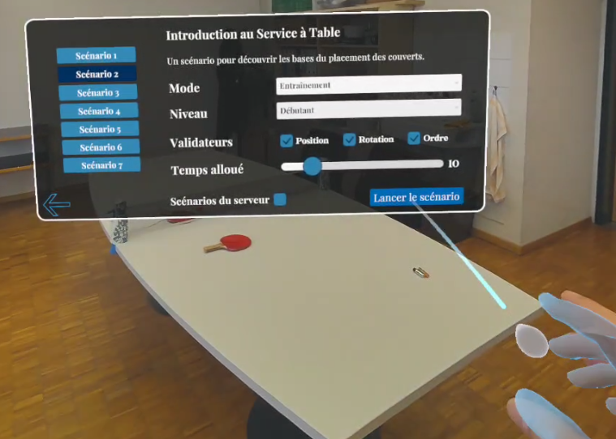

## Mise en place

Lorsque le scénario est lancé, il nous faudra d'abord mettre en place notre environnement de jeu. Pour ce faire, il faudra se déplacer dans l'espace avec la table devant nous et lorsque nous sommes content d'où nous sommes il faut faire un pouce de la main gauche afin de placer la table (faire un pouce vers le bas de la main gauche réinitialise le tout pour replacer la table.)

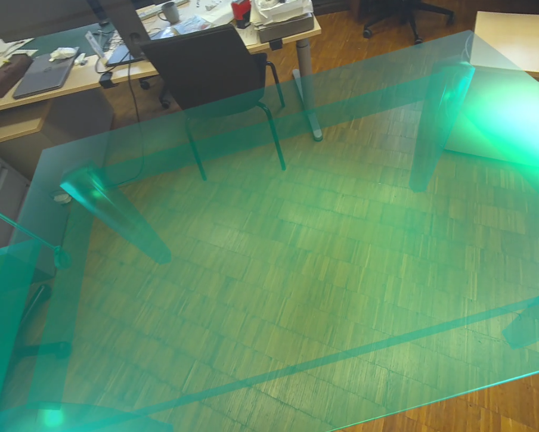
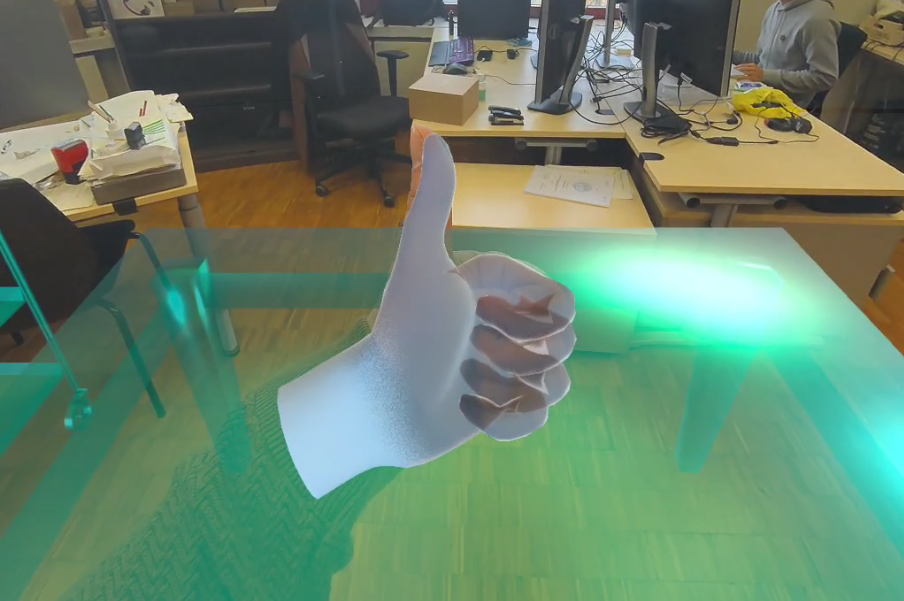
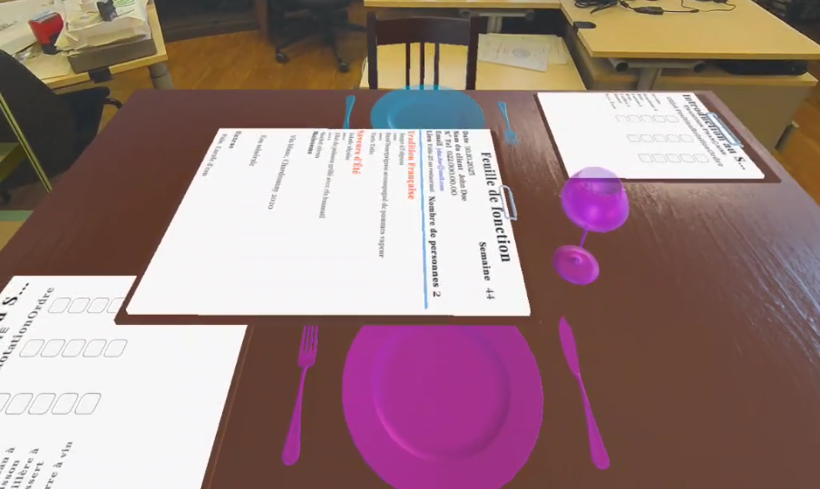

## Scénario

Afin de débuter le scénario, lors que la table est placée convenablement. Il faut faire un pouce vers le haut de la main droite. 

Note : Il faut "pincer" les objets afin de le prendre en main.

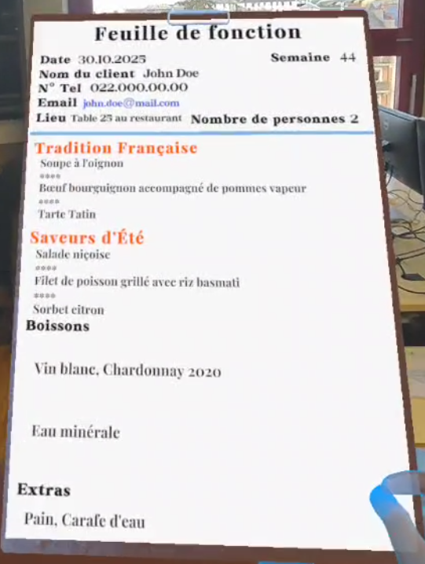
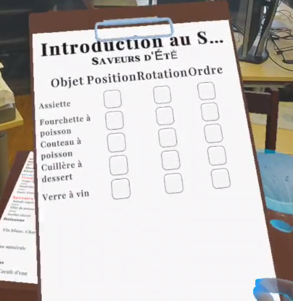
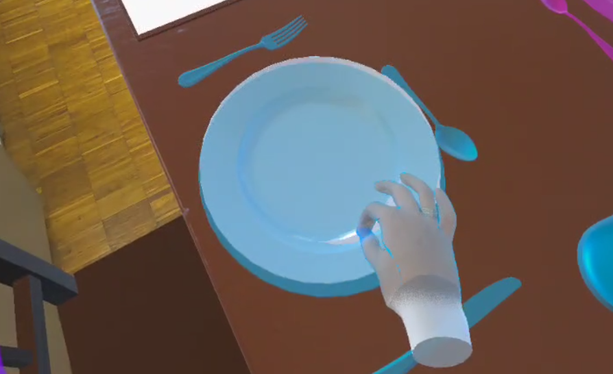
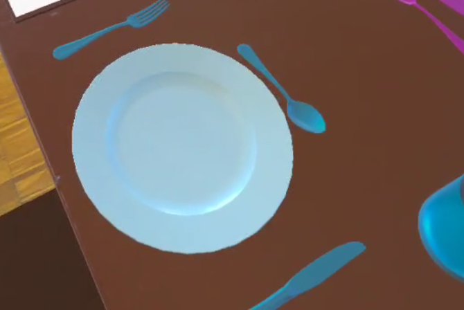
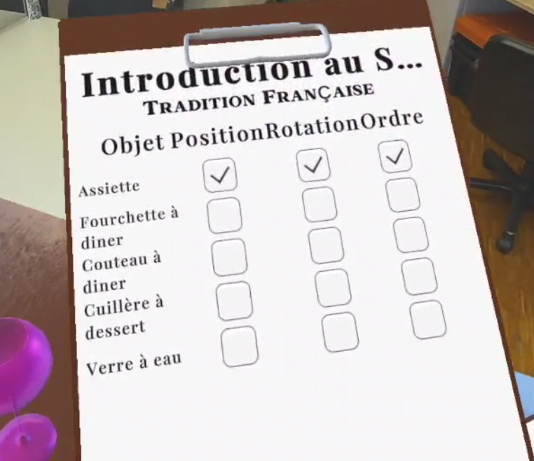
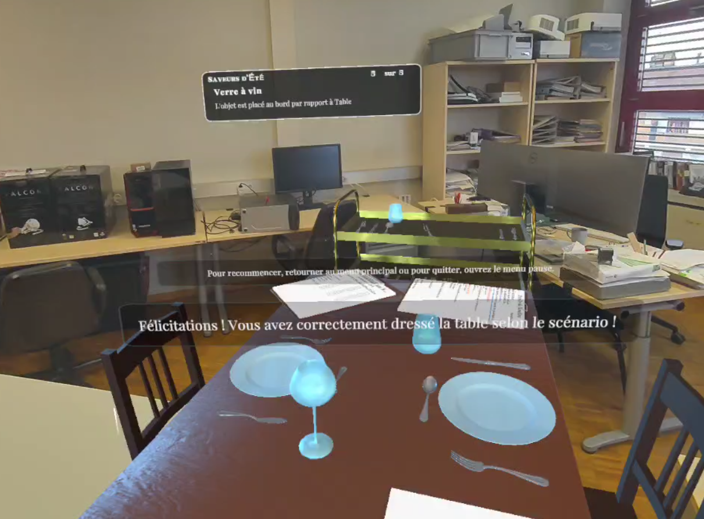