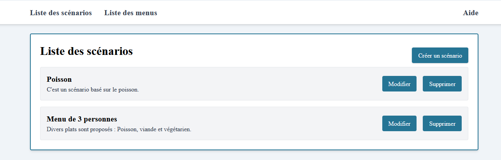
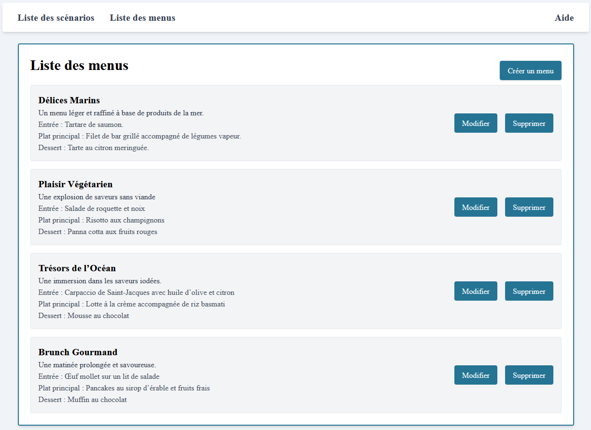
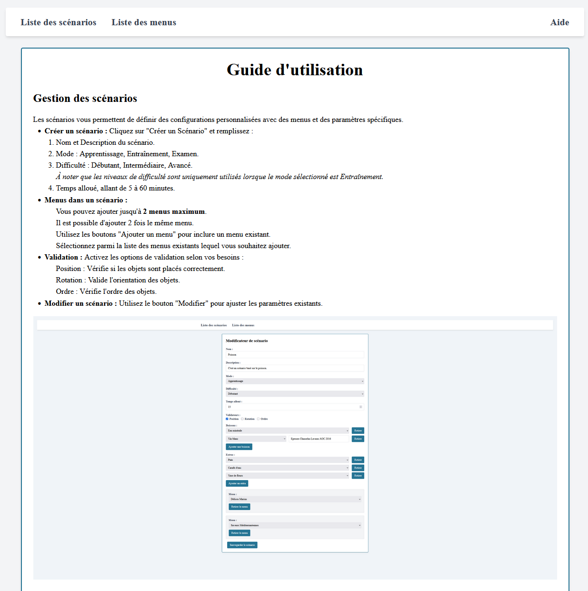
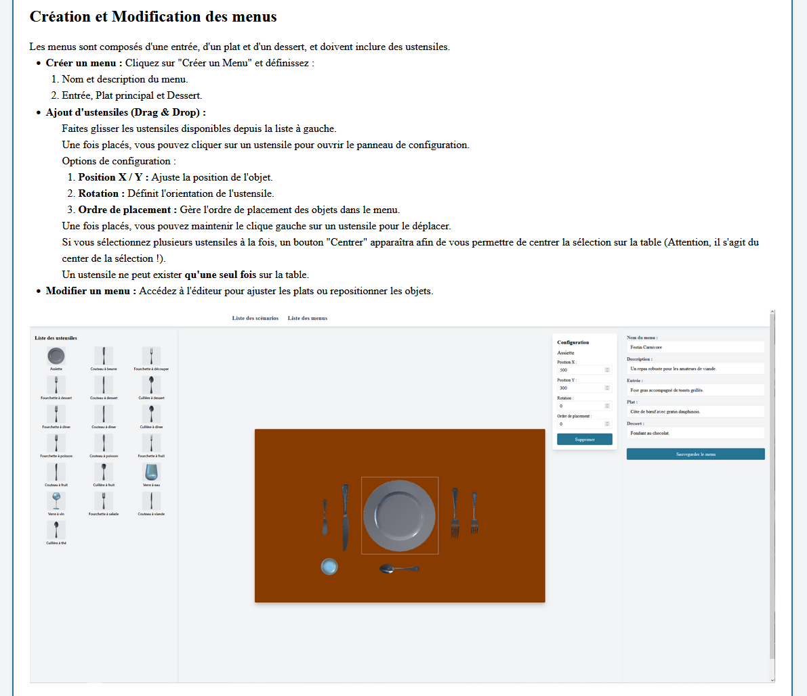
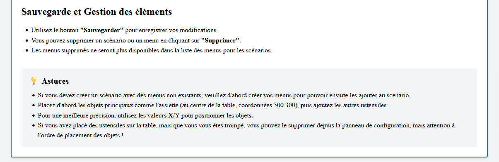

# Scenario creator

## Liste des scénarios - Accueil

Cette section affiche tous les scénarios enregistrés.
Chaque scénario contient un nom, une description et peut être modifié ou supprimé.
Le bouton "Créer un scénario" permet d’en ajouter un nouveau en définissant ses paramètres (mode, difficulté, temps, menus associés).

## Liste des menus

Cette page regroupe tous les menus disponibles, composés d’une entrée, d’un plat et d’un dessert.
Chaque menu peut être modifié ou supprimé, et le bouton "Créer un menu" permet d’en créer un nouveau.
Ces menus peuvent ensuite être associés à des scénarios.

## Aide

Le guide d’utilisation explique le fonctionnement de l’application :

Gestion des scénarios : création, ajout de menus, validation et modification.
Création et modification des menus : ajout d’ustensiles par glisser-déposer, positionnement et rotation.
Sauvegarde et gestion : enregistrement des modifications, suppression d’éléments, et conseils pratiques pour un placement précis des objets.

